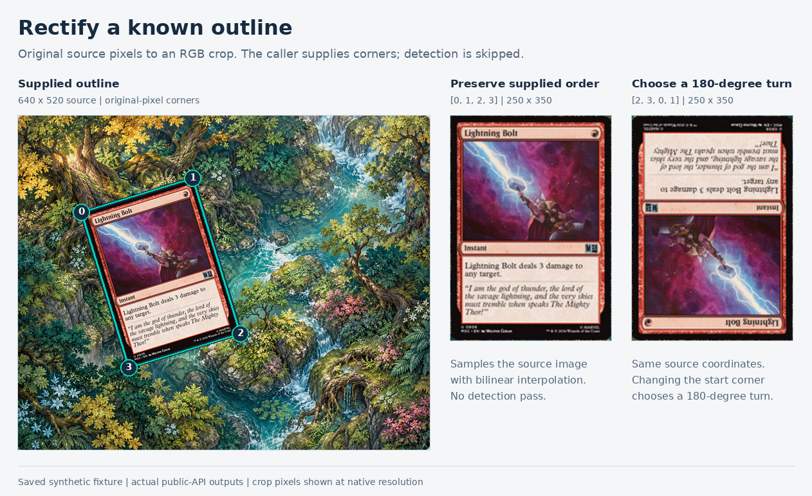

# Known-corner rectification benchmark

This compares `CardExtractor::extract` in Full mode at a maximum detection
dimension of 640 with `CardExtractor::rectify` using corners obtained beforehand.
Both produce a 250×350 RGB crop from the same decoded RGB8 frame. Rectification
includes validation, output allocation, and bilinear sampling. It excludes the
detection or tracking needed to supply corners; these measurements do not
establish complete-frame throughput or Android handset performance.

Run from any directory:

```sh
python3 /path/to/magicextract/benchmarks/rectification/run.py
```

To prepare while other checks run and measure only after the machine is quiet:

```sh
python3 benchmarks/rectification/run.py --build-only
python3 benchmarks/rectification/run.py --run-only --output target/rectification-benchmark/results.json
```

The runner uses the repository's locked dependencies and compiles a standalone
helper without modifying Cargo files or enabling additional dependencies.
`--run-only` rejects changes to the compiled library sources, harness sources,
or executable bytes since preparation.

The three saved fixtures are the plain green Lightning Bolt scene, the forest
playmat Lightning Bolt scene, and the normal forest camera scene. Their exact
file hashes are checked against the manifests before decoding. For each input,
detection runs once before measurement, and the helper verifies the known-corner
crop is pixel-for-pixel identical to the corresponding `extract` crop.

Each operation receives five warmup calls and 31 retained calls per scene.
Operation order alternates. Input decoding, RGB conversion, integrity checks,
pixel comparison, output destruction, and serialization are outside timing.
Results include every sample, median, nearest-rank p95, maximum, original-image
corners, fixture hashes, compiled source hashes, binary hash, build commands,
toolchain, CPU, OS, and Git state.

## Recorded desktop samples

The [saved run](results-desktop.json) used an AMD Ryzen 7 PRO 7840U under WSL2,
Rust 1.99.0, and the release build. All three crop pixel comparisons passed.
These are milliseconds from one paired run, with 31 calls per operation:

| Scene | Extract median | Extract p95 | Rectify median | Rectify p95 |
| --- | ---: | ---: | ---: | ---: |
| Plain green background | 54.906 | 73.963 | 5.293 | 9.129 |
| Forest playmat | 175.261 | 271.847 | 5.377 | 9.463 |
| Normal forest camera fixture | 126.612 | 153.235 | 5.029 | 6.863 |

The [host observation](host-observation-after.json) was collected after timing.
It recorded an elevated one-minute load average decreasing from 5.18 to 4.84,
an unrestricted 16-CPU affinity, no cgroup CPU quota or recorded throttling,
and no compiler or benchmark process at the end of that observation. It does
not establish activity during the timing interval or explain the slower
absolute measurements. Windows-host scheduling and power state were not
observable from the WSL guest.

Use the operations paired within this run to assess the work avoided when
corners are already available. These absolute timings are not comparable with
the earlier benchmark run. This is not an Android result and includes no
camera capture/conversion, tracker, OCR, or display work. The camera fixture is
a saved image, not a live camera measurement.

## Visual example



Both crops are actual public `rectify` calls, shown at their native resolution.
The second call rotates the supplied corner order by two; it does not infer the
artwork orientation. Reproduce the image with Rust, Python, Pillow, and the
DejaVu Sans fonts installed:

```sh
python3 benchmarks/rectification/render-example.py
```

[Visual provenance](example-provenance.json) records the original fixture,
source-pixel corners, compiled source hashes, and output pixel hashes. The
renderer obtains its corners from the saved timing report and performs no
detection or timing. A separately computed 180-degree reference differs from
the second API crop by at most one channel value due to floating-point sampling.
