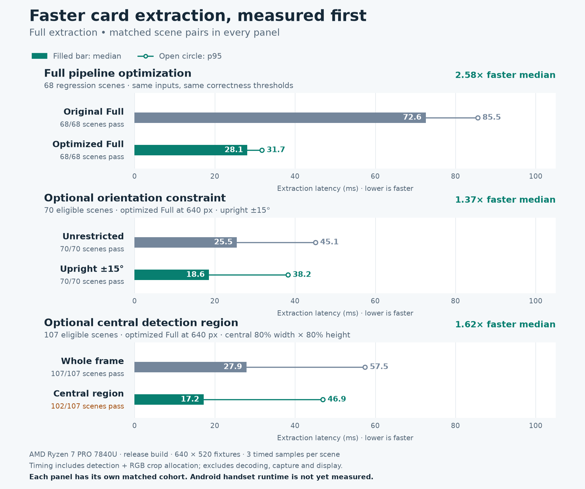
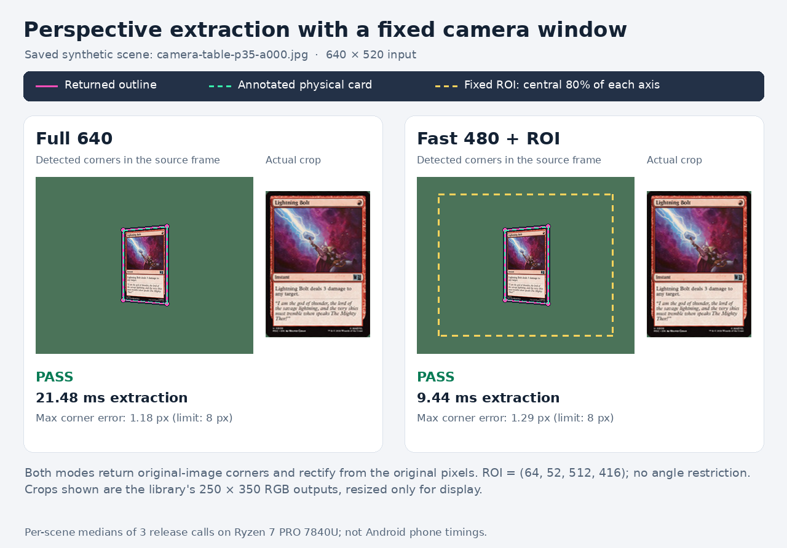
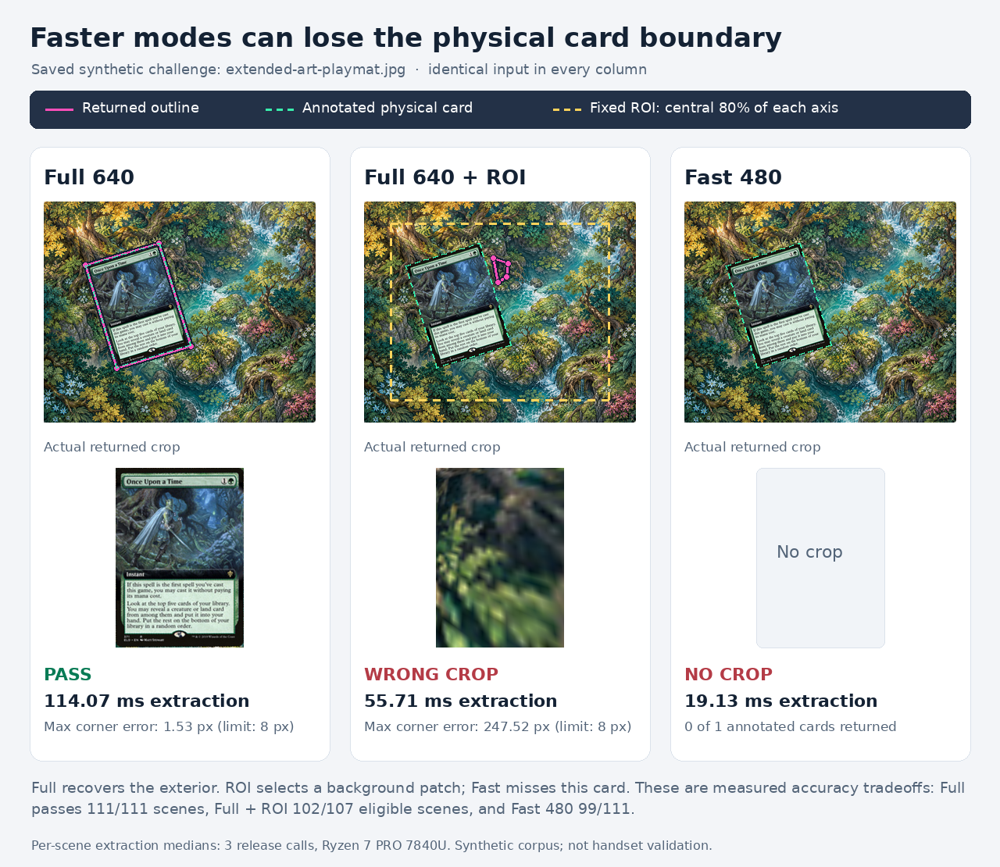

# Detection performance

The optimized full detector retains all recovery passes and accepts every angle.
For a camera application, start with `DetectionMode::Full` and
`max_detection_dimension: 640`. The default dimension remains 1600; all images
in this experiment were already 640×520, so default and Full 640 process the
same pixels. Large camera frames need their own measurements.

The implementation includes a faster Canny filter, shared lazy RGB preprocessing,
borrowed RGB input for rectification, and cached focal-length search constants.
An optional source-pixel region and short-edge orientation constraint reduce the
domain. `DetectionMode::Fast` additionally omits recovery work and has measurable
accuracy costs. Configuration and coordinate semantics are in [usage](usage.md).

## Measured results

On the same 68 primary regression scenes, Full extraction decreased from
**72.61 ms to 28.13 ms median (2.58× faster)**, with 68/68 scenes passing
both before and after. The p95 decreased from 85.52 to 31.73 ms; the maximum
observed call decreased from 100.18 to 55.17 ms. Detection alone decreased
from 70.18 to 25.64 ms median (2.74×).



The expanded 111-scene matrix below uses the final optimized implementation.
Times are milliseconds. Accuracy is passing scenes over eligible scenes, and
p95/max refer to complete extraction. Eligibility differs across restricted
rows, so use the matched comparisons in the next section to assess speedups.

| Configuration | Pass/eligible | Detect median | Extract median | Extract p95 | Extract max |
| --- | ---: | ---: | ---: | ---: | ---: |
| Full default | 111/111 | 25.43 | 28.02 | 83.08 | 135.15 |
| Full 640 | 111/111 | 25.59 | 28.02 | 82.65 | 135.55 |
| Full 480 | 107/111 | 21.13 | 23.71 | 57.32 | 63.26 |
| Full 320 | 100/111 | 12.72 | 15.24 | 40.67 | 44.23 |
| Fast 640 | 100/111 | 6.69 | 9.15 | 30.23 | 34.46 |
| Fast 480 | 99/111 | 7.63 | 10.05 | 21.65 | 26.43 |
| Fast 320 | 91/111 | 4.24 | 6.68 | 12.26 | 17.01 |
| Full 640 + ROI | 102/107 | 14.75 | 17.20 | 46.92 | 113.17 |
| Full 640 + angle | 70/70 | 16.01 | 18.57 | 38.21 | 73.82 |
| Full 640 + ROI + angle | 67/69 | 12.45 | 15.02 | 19.14 | 53.21 |
| Fast 480 + ROI | 94/107 | 7.74 | 10.21 | 21.49 | 30.60 |
| Fast 480 + angle | 64/70 | 7.46 | 9.71 | 19.41 | 27.45 |
| Fast 480 + ROI + angle | 63/69 | 7.64 | 9.91 | 14.21 | 26.96 |

Full passes all 111 evaluated scenes, but difficult recovery cases bring its
extraction p95 to 83.08 ms. Its median alone does not establish a 15 FPS budget.
Fast 480 lowers p95 to 21.65 ms while failing 12 of the 111 scene checks.
Fast 640 has a lower median than Fast 480 in this corpus because resizing also
changes contours and recovery work; pixel count alone does not predict latency.

A separate five-call repeat on the plain, forest playmat, and normal camera
scenes found Fast 480 + ROI extraction medians of 9.92, 20.65, and 20.84 ms.
All three passed, but the broader 94/107 result above establishes the limits
that those representative examples miss.

## What restricting the domain changes

The region is fixed before looking at annotations: the central 80% of each
axis, or 64% of the input pixels. The angle restriction is 0° ±15°, modulo
180°, measured from the mean direction of the card's two short edges.
Negatives are eligible in every domain. A positive scene is eligible only when
every annotated card fits the requested region and angle. Reports retain
out-of-domain scenes, but exclude them from domain accuracy and timing summaries.

Each pair below uses exactly the same eligible scenes on both sides.
These are additional effects within the optimized detector.

| Change | Scenes | Extract median before → after, ms | Speedup | Accuracy before → after |
| --- | ---: | ---: | ---: | ---: |
| Full 640 → Full 640 + ROI | 107 | 27.89 → 17.20 | 1.62× | 107 → 102 |
| Full 640 → Full 640 + angle | 70 | 25.53 → 18.57 | 1.37× | 70 → 70 |
| Full 640 + ROI → Full 640 + ROI + angle | 69 | 16.83 → 15.02 | 1.12× | 65 → 67 |
| Fast 480 → Fast 480 + ROI | 107 | 10.05 → 10.21 | 0.98× | 95 → 94 |
| Fast 480 → Fast 480 + angle | 70 | 9.81 → 9.71 | 1.01× | 65 → 64 |
| Fast 480 + ROI → Fast 480 + ROI + angle | 69 | 9.92 → 9.91 | 1.00× | 63 → 63 |

Angles reduce Full work while preserving all 70 eligible scene checks here.
The central window speeds up Full but introduces five failures. In Fast 480,
ROI and angle effects are around ±2%, with no useful latency improvement in
this experiment. Do not interpret those small changes as a reliable speedup.

Cropping at Full 640 reduces the working image from 640×520 to 512×416.
At Fast 480, both full-frame and region processing resize to 480×390, so the
region supplies more card detail without reducing the number of pixels scanned.
That is why a smaller screen window does not automatically make that mode faster.
Angle restrictions reject candidates before expensive recovery, but still pay
for grayscale conversion, edge filtering, and contour traversal.

ROI processing preserves the original camera principal point, returns original
image coordinates, and rectifies from original image pixels. Even with those
properties, cropping changes threshold statistics, contour connectivity, and
which enclosing outlines are available. In this experiment the Full ROI failures
include steeply foreshortened cards and an extended-art scene where a small
background patch was mistaken for the card. Fast mode particularly loses
overlapping cards and difficult borderless/extended-art exteriors. These options are deliberate tradeoffs, not
accuracy-equivalent replacements for Full.

## Actual detection and crop examples

These saved synthetic scenes illustrate the measured results. Crops were
regenerated through the production Rust extractor; the generator checks
detections against the archived report. Timings are per-scene medians from
the release benchmark on the desktop host.

Full 640 and Fast 480 with a fixed central window both recover this perspective
view, return source-image coordinates, and rectify from the original pixels:



On this extended-art challenge, Full finds the physical card. The central-window
variant returns a background patch, and Fast returns no crop:



To regenerate the chart and examples, install Matplotlib and Pillow in a Python
environment with DejaVu Sans fonts, then run:

```sh
python3 benchmarks/2026-10-20/render-performance-chart.py
python3 benchmarks/2026-10-20/render-detection-examples.py
```

The examples generator builds a small Rust helper against the locked production
library. [Visual provenance](../benchmarks/2026-10-20/images/detection-evidence.json)
records the fixture hashes, source hashes, actual corners, and crop hashes.

## Canny and SIMD

Profiling the original implementation identified Canny as the largest repeated
cost. The replacement specializes the sigma-1.4 Gaussian filter, fuses Sobel
derivatives with squared magnitudes, and classifies gradient directions
algebraically. It retains the reference floating-point fallback at rare direction
boundaries, calls `hypot` for surviving maxima to preserve threshold semantics,
and preserves the reference hysteresis traversal.

The Gaussian and interior Sobel loops compile to x86 SIMD and Android ARM64 NEON
using ordinary safe Rust. The library continues to forbid unsafe code and adds
no dependencies. Android ARM64 library checking and release code generation
passed; this is compilation evidence, not a phone timing result.

The isolated 640×480 Canny measurements decreased from 10.7–12.0 ms to
1.7–2.1 ms on three saved scenes. End-to-end gains are smaller because contour
analysis, geometry, recovery, and crop generation still take time.
The compatibility audit compared 1,808 edge masks across 226 images, four
channels, and two threshold pairs: all 601,702,400 pixels matched the upstream
implementation. Unit tests cover all 4,165,681 integer Sobel direction pairs,
tiny images, Gaussian rounding, and exact threshold boundaries. A separate
audit checked magnitude ordering over all possible nonnegative Sobel gradients.
These checks were executed on this host; ARM64 output equivalence still needs a
device execution.

The [archived evidence](../benchmarks/2026-10-20/) includes timings, equivalence
counts, magnitude checks, and NEON assembly excerpts. Reproduce the edge probes:

```sh
python3 benchmarks/2026-10-20/run-edge-probe.py verify
python3 benchmarks/2026-10-20/run-edge-probe.py bench
python3 benchmarks/2026-10-20/profile-baseline.py
```

The `optimized-native-edges640.txt` experiment used host-specific compiler flags
before the final Sobel improvement. The main results use the portable release
build with no `RUSTFLAGS`.

## Benchmark method and reproduction

Measurements were taken on 2026-10-20 using an AMD Ryzen 7 PRO 7840U under WSL2,
Rust 1.99.0, release builds, and a single caller thread. Project builds, tests,
and other timing jobs were stopped during measurement. This does not control
the host's frequency, scheduler, or thermal state.

The complete matrix covers 111 saved scenes: 68 primary regressions,
28 camera regressions, two playmats, seven border regressions, and six
borderless/extended-art challenges. Each variant uses one warmup and three timed
calls per API per scene. Calls alternate `detect` and `extract`; `extract`
includes detection and allocation of the default 250×350 RGB crops. Fixture hash
checks, decoding, scoring, and JSON output happen outside the timed calls.
Accuracy requires the annotated card count, unique corner assignment, corner tolerances, and crop
appearance limits; thresholds and annotations were not relaxed for Fast mode.

Percentiles use nearest rank over equally weighted individual calls. They
describe this corpus, not the distribution of future live camera frames.
The original before/after comparison uses the same 68 primary regressions and
the same timing/scoring harness adapted to the old public API. Other table rows
compare optimized configurations; their speedups must not be described as
before/after changes to the original detector.

```sh
cargo run --locked --release --example benchmark -- \
  --manifest tests/fixtures/scenes/manifest.json \
  --manifest tests/fixtures/camera/manifest.json \
  --manifest tests/fixtures/playmats/manifest.json \
  --manifest tests/fixtures/borders/manifest.json \
  --challenge-manifest tests/fixtures/art-treatments/manifest.json \
  --iterations 3 --warmup 1 \
  --output target/performance/domain-final.json
```

Use `--help` for individual scenes/variants, pixel or normalized regions,
angles, and repetition counts. Input decoding remains outside the timed loop.
The JSON records every sample, accuracy details, domain membership, executable
hash, compile-time source hashes, toolchain, and machine information.

The frozen baseline is commit `63d2bbaf3626f77254a8d9c53d4b2cf5465d96e5`.
To reproduce it in a separate checkout, decompress
`benchmarks/2026-10-20/baseline-benchmark.rs.gz` from this checkout into the
baseline checkout's `examples/benchmark.rs`, then run:

```sh
cargo run --locked --release --example benchmark -- \
  --variant default --iterations 3 --warmup 1 \
  --output target/performance/baseline-primary.json
```

The [archived baseline](../benchmarks/2026-10-20/baseline-primary.json.gz),
[final matrix](../benchmarks/2026-10-20/domain-final.json.gz),
[focused repeat](../benchmarks/2026-10-20/focused-final.json.gz), and
[readable summary](../benchmarks/2026-10-20/summary-final.json) retain the evidence.
Both final reports used the same executable, and their compile-time source
hashes match the [archived checksums](../benchmarks/2026-10-20/compiled-source.sha256).
Regenerate the summary using the standard-library-only script:

```sh
python3 benchmarks/2026-10-20/summarize.py
```

[Verification records](../benchmarks/2026-10-20/verification.json) cover the full
stable debug suite, the final MSRV 1.90.0 release suite, all-target checking and
Clippy on both toolchains, and formatting. There are 111 passing tests including
the doctest; four pre-existing adversarial/challenge tests remain explicitly
ignored. The performance matrix separately evaluates its declared 111 scenes.

## Phone budget and further research

The intended app platform is Android. No particular handset model has been
specified, and these measurements were not executed on an Android device.
The ARM64 compilation checks can be repeated without linking an application:

```sh
rustup target add aarch64-linux-android
cargo check --locked --lib --target aarch64-linux-android
cargo rustc --locked --release --lib --target aarch64-linux-android -- --emit=asm
```

15 FPS permits 66.7 ms for the complete frame pipeline. These measurements cover
outline detection and crop extraction only. Camera capture, pixel format
conversion, display, downstream card identification, power consumption, and
sustained thermal behavior need measurements on the intended handset. This
library identifies outlines; it does not identify the depicted card.

Benchmark Full 640 first on that device, then compare an application guide
region and permitted angles on the same recorded frames. Select Fast only if
its missed outlines and crop errors are acceptable for the supported inputs.
Do not call both `detect` and `extract` for each frame when the crops are needed:
`extract` already returns each detection with its crop.

The [edge research notes](edge-research.md) assess ELSED, PiDiNet, and TEED
against primary papers. A local ELSED experiment confirms a fast segment
frontend, but the existing quadrilateral grouping and exterior selection do
not yet meet the speed and accuracy requirements. It remains an investigation
candidate; no learned model, C++ frontend, or extra runtime was added to the
production crate.
